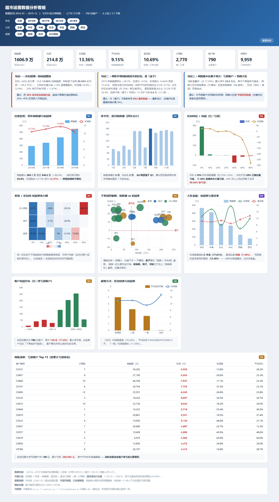

# 超市运营数据分析 · Retail Operations Analytics

> 用 4 年、9,959 行零售订单数据回答一个问题：**钱被什么吃掉了。**
> 从数据预处理 → 六大业务模块分析 → 交互看板 / Excel 汇总表 / 业务分析报告的全自动分析链路。



---

## 核心结论

这几个数字是整个项目的价值所在，也是"业务分析"与"技术分析"的分水岭。

| # | 结论 | 关键数字 |
| --- | --- | --- |
| 1 | **折扣是唯一的利润黑洞** | 折扣 ≥40% 的订单占销售额 18.96%，却制造了全网 **90.86% 的亏损**（−89.4 万元） |
| 2 | **"增收不增利"的真因不是折扣，是「桌子」** | 2019 年销售额 +28.7% 而利润仅 +9.5%；用排除法定位到家具占比 33.29%→36.39%，且子类「桌子」亏损从 1.9 万扩大到 6.6 万（3.5 倍） |
| 3 | **风险集中在人** | 790 位客户中有 139 位（17.59%）累计净亏 **26.9 万元** |
| 4 | **西南大区是"低利 + 高退"双差区** | 利润率最低 7.49%，退货率最高 12.45% |

## 技术栈

Python（pandas / numpy / openpyxl）· ECharts 5（单文件离线内联）· Playwright（浏览器端验证）

## 工程亮点

- **业务导向，不做技术炫技**：负利润 2,041 行全部保留并归因到具体折扣档与子类，而不是当作异常值删掉——删掉就等于抹平一个 98.4 万元的真实经营问题。
- **规避"不处理就会得出错误结论"的坑**：退货表 1,163 行实际只对应 296 单（867 行完全重复），不去重会把退货率从 10.69% 虚报成 41.99%，结论直接反过来。
- **三层交叉核对**：Excel ↔ metrics.json ↔ 原始数据独立重算，**94 项断言全部通过**。
- **真实浏览器验证**（非静态断言）：Playwright 驱动，8 张图渲染 + KPI 与 Python 口径逐项比对 + 筛选器真实点击联动，**13 项全部通过**。
- **一键复现**：`python scripts/build_all.py` 从原始数据跑完全链路，约 7 秒。

---

## 一、快速开始

**前置条件**：本项目不附带原始数据（数据集含客户姓名，故不入库）。请把你的表格放进 `data/`，或运行时用 `--input` 指定。

```bash
git clone https://github.com/HuTa000/supermarket-ops-analysis.git
cd supermarket-ops-analysis

# 1) 放入数据（三张表：订单 / 退货 / 销售人员）
#    —— 表名或列名不同也没关系，改 config.json 的「表名」「字段映射」即可
#       不确定怎么填就先跑：python scripts/convert_xls.py --input <你的文件>
cp /path/to/你的数据.xlsx data/

# 2) 一键跑完全链路（预处理 → 分析 → 看板 → Excel → 交叉核对）
python scripts/build_all.py

# 3) 看板真实浏览器验证（可选，需 Node + playwright）
node scripts/verify_dashboard.cjs
```

依赖：`pandas`、`numpy`、`xlrd`、`openpyxl`（读旧版 `.xls` 需要 `xlrd`）。

> **只想看结果**，不打算跑代码？直接打开 `超市运营分析_交互看板.html`（单文件、离线可开），
> 或看 `超市运营分析报告.md` 与 `outputs/dashboard_preview.png`。

---

## 二、目录结构

```
supermarket-ops-analysis/
├── config.json           ← 换数据只改这个文件（输入文件 / 表名 / 字段映射 / 输出前缀）
├── data/                 ← 把你的原始数据放这里（.xlsx / .xlsm / .xls，不入库）
├── scripts/
│   ├── _paths.py         路径与配置解析（项目可整体搬盘）
│   ├── etl.py            W1 预处理：三表整合 / 退货去重 / 派生字段 / 质量台账 / 对账
│   ├── analysis.py       W2-W3 六大业务模块 → metrics.json
│   ├── build_dashboard.py W4 生成单文件 HTML 看板
│   ├── build_excel.py    W5-A 生成 Excel 多 Sheet 汇总表
│   ├── crosscheck.py     W5-C 交付物交叉核对
│   ├── convert_xls.py    工具：.xls → .xlsx 并打印结构摘要
│   ├── verify_dashboard.cjs  看板浏览器验证
│   └── build_all.py      一键复现
├── templates/dashboard.html  看板模板（含 __ECHARTS__ / __DATA__ 占位符）
├── vendor/echarts.min.js     离线 ECharts
├── outputs/              中间产物（不入库，仅保留 dashboard_preview.png）
├── 超市运营分析_交互看板.html  ← 交付物 1（单文件，离线可开）
├── 超市运营分析_汇总表.xlsx    ← 交付物 2（9 个 Sheet）
└── 超市运营分析报告.md         ← 交付物 3
```

**项目可以整体移动到任意盘符**——所有路径由 `scripts/_paths.py` 从脚本位置反推，脚本内不再有硬编码盘符。

---

## 三、换一组数据能不能直接跑？

**分三档，取决于新数据的「结构」和「业务」是否同构。**

### 第一档 · 结构完全同构 → ✅ 直接跑，零改代码

新数据同样是三张表（订单 / 退货 / 销售人员），列名与现在完全一致，只是数值不同。

```bash
# 把新文件丢进 data/，跑一条命令
python scripts/build_all.py

# 或者临时指定别的文件
python scripts/build_all.py --input "D:/别的数据.xlsx"
```

产物文件名前缀可通过 `config.json` 的 `输出前缀` 改。

### 第二档 · 结构不同但业务同构 → ⚠️ 改配置能跑一半

比如表名叫「销售明细」「退款记录」，或者列名是 `order_id` / `sales` / `profit`。
把新文件放进 `data/`，先跑一次结构体检：

```bash
python scripts/convert_xls.py --input "D:/新数据.xls"
```

它会直接告诉你：哪张表没命中、哪个必需字段没找到，以及源文件实际有哪些列。然后按提示填 `config.json` 的 `表名` 与 `字段映射`：

```json
{
  "输入文件": "data/新数据.xlsx",
  "输出前缀": "新项目名",
  "表名":   { "订单": "销售明细", "退货": "退款记录", "销售人员": "区域负责人" },
  "字段映射": { "订单 ID": "order_id", "销售额": "sales", "利润": "profit" }
}
```

**这一档的坑在"叙事层"**：脚本算出来的数字会正确更新，但看板和报告里的**业务结论文字是写死的**（见下节），不会跟着变，必须人工重写。

### 第三档 · 业务不同 → ❌ 不能直接用

如果新数据不是「订单-商品-客户-地区-折扣」这套零售交易结构（例如日志、埋点、传感器、工单），计算层要重写——`折扣`、`退货`、`子类别`、`邮寄方式` 这些概念根本不存在。图表层和 Excel 层的框架可以复用，但每个模块都要换。

---

## 四、可移植性对照表（换数据时到底要动哪里）

| 层 | 文件 | 能否自动适配 | 说明 |
| --- | --- | --- | --- |
| **配置层** | `config.json`、`scripts/_paths.py` | ✅ 完全通用 | 表名、字段映射、输入路径、输出前缀全部外置 |
| **预处理层** | `scripts/etl.py` | ✅ 通用 | 三表整合、退货去重、派生字段、质量台账，逻辑与业务无关 |
| **计算层** | `scripts/analysis.py` | ⚠️ 大部分通用 | 聚合逻辑通用，但以下常量写死 |
| **图表层** | `templates/dashboard.html` | ⚠️ 大部分通用 | 8 张图由数据驱动，但配色与标线绑定品类名 |
| **叙事层** | 看板结论卡 / 报告.md / Excel 批注 | ❌ 必须人工重写 | 结论文字与具体数字是写死的 |

### 计算层写死的位置

| 位置 | 内容 |
| --- | --- |
| `analysis.py:96` | `CATS = ["家具", "技术", "办公用品"]` |
| `analysis.py:105` | 归因里写死子类别 `"桌子"` |
| `analysis.py:173` | 类别 × 折扣档利润矩阵的品类循环 |
| `analysis.py:349` | `"邮寄方式": ["标准级", "二级", "一级", "当日"]` |
| `analysis.py:110-114` | 2019 年利润率下滑的归因结论文本 |

### 图表层与叙事层写死的位置

| 位置 | 内容 |
| --- | --- |
| `templates/dashboard.html:105-121` | 三张结论卡（含「桌子」「西南 7.49%」等具体数字） |
| `templates/dashboard.html:415` | `catColor` 三个品类的固定配色 |
| `templates/dashboard.html:428` | `markLine: cat === '家具'` |
| `templates/dashboard.html:561,564` | 散点图与区域图的硬编码结论句 |
| `scripts/build_excel.py:148-150` | 「家具占比 / 家具利润率 / 桌子利润」三行固定行 |
| `超市运营分析报告.md` | 全篇叙事 |

---

## 五、三个交付物的定位

| 文件 | 定位 | 换数据的适配成本 |
| --- | --- | --- |
| **交互看板 .html** | 可交互、可分享，8 张图 + 三维筛选联动 | 低（改配色/结论卡即可） |
| **汇总表 .xlsx** | 9 个 Sheet，关键指标 + 六大模块 + 数据质量台账 | 低（改固定行与说明） |
| **分析报告 .md** | 结论 + 建议 + what-if 测算 | 高（全文重写） |

---

## 六、核心业务口径（换数据时需重新确认）

1. **利润率** = 利润 / 销售额
2. **负利润是业务真实值，不是异常值，必须保留**——不做 3σ 剔除
3. **退货率分母 = 唯一订单数**，分子 = 退货表**去重后**的唯一订单数
   （本项目退货表 1,163 行实际只对应 296 单，不去重会把 10.69% 算成 41.99%）
4. 退货率、客单价等订单粒度指标，必须先去重到订单粒度再聚合
